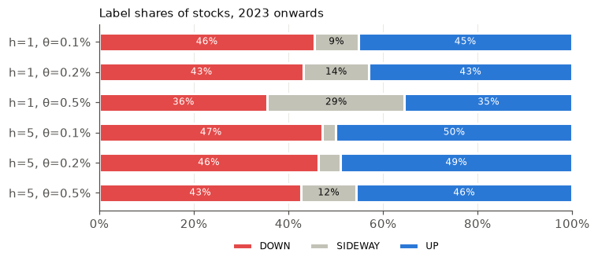
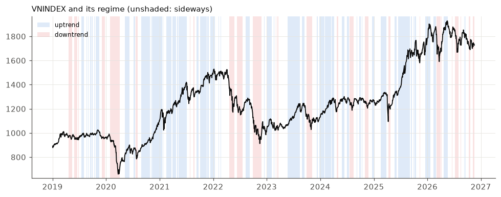

# Báo cáo tiến độ đồ án DX6000 – 26/11/2026 (tuần 4/13)

Học viên: Nguyễn Bá Anh · Giảng viên hướng dẫn: Trần Việt Trung

Chủ đề: **hiểu dữ liệu** (notebook `01_data_understanding`)

## 1. Tóm tắt kết quả

- **Dữ liệu Arena dùng được.** Không có ngày trùng, gần như không thiếu phiên. Em tìm ra
  ba vấn đề và đã xử lý cả ba: mã từng chuyển sàn, giá điều chỉnh cổ tức còn sót, và nến
  chép.
- **Sửa quy tắc lọc dữ liệu.** Trước đây code áp biên độ của sàn hiện tại cho cả lịch sử,
  nên đánh dấu nhầm nhiều phiên hợp lệ. Áp biên độ theo sàn của từng ngày thì số phiên
  đáng ngờ giảm từ 340 xuống 37.
- **Chốt các lựa chọn về dữ liệu.** Giữ ngưỡng đi ngang θ = 0,2%. Tạm giữ mẫu từ 2023: học
  từ 2020 tốt hơn nhưng chưa có ý nghĩa thống kê. Kết quả baseline gần như không đổi.

## 2. Hiện trạng

| Vấn đề | Phát hiện | Xử lý |
|---|---|---|
| Chuyển sàn | 14 mã đổi sàn từ 2019 (ví dụ ACB từ HNX, BSR từ UPCoM lên HOSE) | Áp biên độ theo sàn của từng ngày; ngày chuyển sàn đối chiếu với báo chí |
| Giá điều chỉnh cổ tức | Arena có điều chỉnh, nhưng sót một số sự kiện (đợt 5–6/2021, TCX và FPT 9/2026) | Loại nhãn ở các phiên vượt biên độ (37 phiên) |
| Nến chép | Arena chép nguyên nến cũ vào ngày mã không giao dịch (686 nến, 0,47%) | Loại nhãn đi qua các nến này |
| Nến vô lý | 75 nến có high/low mâu thuẫn, chủ yếu trước 2023 | Chỉ ghi nhận, vì nhãn dùng giá đóng cửa |
| PNJ giảm 51% tháng 7/2026 | 9 phiên giảm sàn, không phiên nào vượt biên độ; báo chí xác nhận | Biến động thật, giữ nguyên |
| Danh sách VN30 | Config còn BVH, thiếu VPL | Đã sửa theo kết quả xét duyệt của HOSE |

## 3. Nguyên nhân

- **Vì sao cần xử lý:** nhãn tăng/giảm tính từ % thay đổi giá. Một bước nhảy giả do cổ tức
  chưa điều chỉnh, hay một nến chép, sẽ tạo nhãn sai, và mô hình học theo nhãn sai đó.
- **Vì sao chỉ loại nhãn mà không tự sửa giá:** Arena không công bố hệ số điều chỉnh, nên
  không sửa chính xác được. Số nhãn bị loại rất ít.
- **Vì sao giữ θ = 0,2%:** khớp cách Arena chấm điểm và giữ nguyên forward test đang chạy.
  Với cổ phiếu, 65% nhãn đi ngang là giá không đổi, do bước giá 50 đ đã tương đương
  0,1–0,5%.
- **Vì sao chưa đổi mẫu sang 2020:** log loss tốt hơn ở cả hai kỳ hạn, nhưng p = 0,09
  (1 phiên) và 0,11 (5 phiên), chưa đạt mức 0,05.

## 4. Hành động

Tuần 5–6:
1. Tách tập holdout, từ 01/06/2026.
2. Dự báo v1: XGBoost, hiệu chỉnh xác suất, thử biến thể nhị phân UP/DOWN, thử lại mẫu từ
   2020.
3. Cập nhật config khi toàn bộ cổ phiếu HNX chuyển sang HOSE ngày 28/12/2026.

### Cần thầy cho ý kiến

1. **Mốc bắt đầu mẫu:** em giữ 2023 và thử lại 2020 với mô hình mạnh hơn. Thầy có muốn
   dùng 2020 ngay không? Mẫu 2023 chưa có thị trường giảm kéo dài như năm 2022 (−40%).
2. **Nguồn dữ liệu thứ hai:** từ 10/11/2026, theo Nghị định 363/2026, vnstock chỉ còn lấy
   dữ liệu qua API của công ty chứng khoán. Em đang đăng ký API của SSI để có thêm khối
   lượng giao dịch và đối chiếu giá với Arena. Thầy thấy việc này có cần cho đồ án không?
3. **Sai lệch do chọn mã (survivorship bias):** danh sách mã là VN30 hiện tại áp cho cả
   lịch sử, nên backtest hơi lạc quan. Em định chỉ ghi nhận đây là hạn chế. Thầy thấy có
   cần dựng lại danh sách VN30 theo từng thời điểm không?

---

## Phụ lục

### A. Số liệu chính

| Chỉ số | Giá trị |
|---|---|
| Dữ liệu | 76 mã có nến (MCH, VPL không có trên Arena), 2019–2026 |
| Phiên đáng ngờ (vượt biên độ) | 340 → 37 sau khi áp biên độ theo ngày |
| Nhãn bị loại từ 2020 (1 phiên / 5 phiên) | 283 → 34 / 1.013 → 145 |
| Tỷ lệ nhãn đi ngang từ 2023 (cổ phiếu / chỉ số) | 1 phiên: 14% / 20%; 5 phiên: 5% / 7% |
| Đợt giảm sâu nhất của VNINDEX | 2022: −40,3%; COVID 2020: −35,7% |

### B. Mẫu từ 2020 so với từ 2023 (logistic, cùng các fold trước 01/06/2026)

| Kỳ hạn | Log loss từ 2023 | Log loss từ 2020 | DM | p |
|---|---|---|---|---|
| 1 phiên | 0,9983 | 0,9950 | −1,71 | 0,087 |
| 5 phiên | 0,8716 | 0,8591 | −1,59 | 0,111 |

### C. Baseline sau khi sửa dữ liệu (01/2024–11/2026)

- 1 phiên: logistic đạt accuracy 0,447, baseline 0,420, DM p = 0,003.
- 5 phiên: chưa có lợi thế (p = 0,10).
- Backtest: −37,0%, so với mua và giữ VN30 +57,5%.

### D. Hình

### E. Tài liệu

- [Notebook hiểu dữ liệu](https://github.com/nguyenbaanh7779/market-radar/blob/feat/data-understanding/notebooks/01_data_understanding.ipynb)
- [Quyết định về dữ liệu (strategy, mục 5–6)](https://github.com/nguyenbaanh7779/market-radar/blob/feat/data-understanding/docs/strategy/README.md)
- [Nguồn đối chiếu chuyển sàn, VN30, sự kiện quyền](https://github.com/nguyenbaanh7779/market-radar/blob/feat/data-understanding/docs/architecture/data_dictionary.md)
